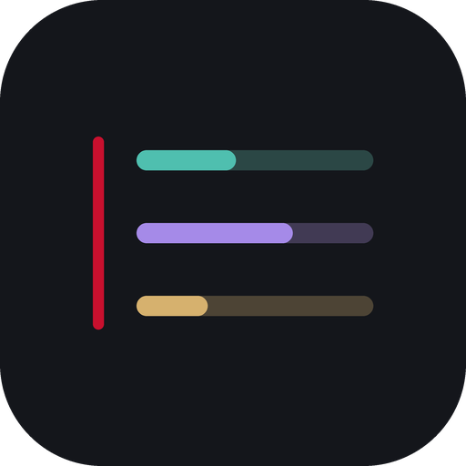
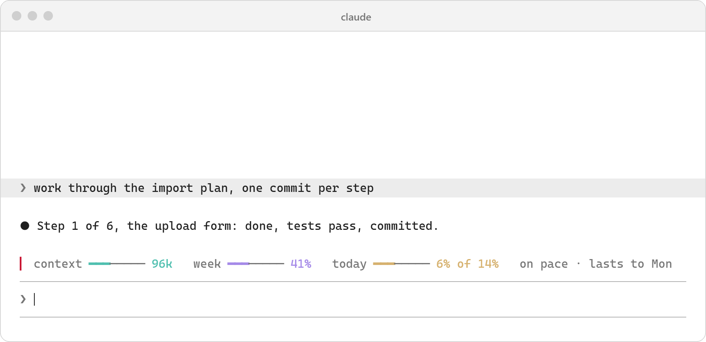
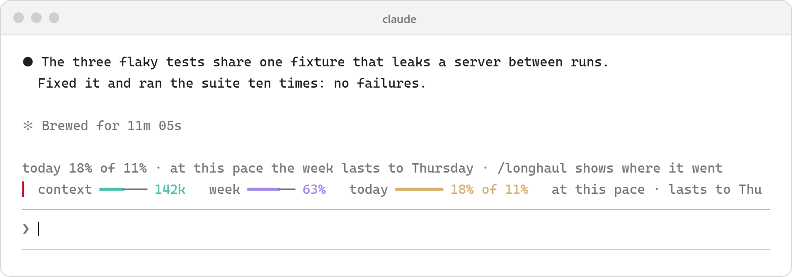
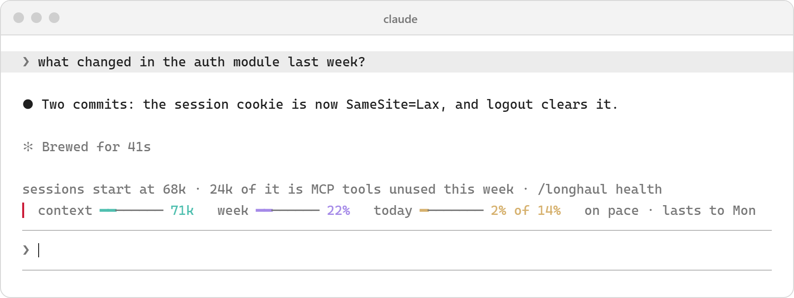

<div align="center">



# longhaul

A Claude Code mod that helps Pro and Max subscribers make the weekly usage limit last.

[](.claude-plugin/plugin.json)
[](LICENSE)
[](PRIVACY.md)

[Install](#install) · [What it does](#what-it-does) · [Settings](#settings) · [Privacy](#privacy)

<picture>
  <source media="(prefers-color-scheme: dark)" srcset=".github/readme/hero-dark.gif">
  
</picture>

<sub>An example session, drawn with the band's own code.</sub>

</div>

## Install

At the prompt of a terminal session:

```
/plugin install longhaul --marketplace sssamuelll/longhaul
```

Answer `y` to add the marketplace, then pick a scope. From a shell:

```
claude plugin install longhaul --marketplace sssamuelll/longhaul
```

In Google Antigravity (`agy`), with Python 3 on `PATH`:

```
git clone https://github.com/sssamuelll/longhaul
agy plugin install ./longhaul
```

In Antigravity it runs through `hooks/antigravity.py`: it tracks context from `transcript.jsonl`, injects compaction checkpoints and subagent handoffs, and answers `longhaul` and `longhaul health` when sent as prompts. Antigravity does not expose the weekly plan meter or let a hook trigger `/compact` on its own, so the hook recommends `/compact` at clean boundaries instead.

## The problem

These are one developer's own measurements, taken from their sessions over a day and a half and weighted by public API prices. Your numbers will differ.

- 36% of the weekly limit was used in about 1.5 days.
- 56% of the usage was Claude re-reading the conversation.
- A typical step carried about 390k tokens of context.
- Auto-compact fired only near 967k, the default for a 1M-token model.
- Compacting at 200k would have saved about 25%.
- Every session started at about 93k tokens before the first prompt.
- Sonnet 5.5 costs half of Opus 5.5 on every token type.

A long conversation is paid for again on every step. Keeping it short, and giving cheap work to the cheaper model, is where the savings are.

## What it does

Six jobs. The guard and classifier have three modes each: `auto` acts, `ask` asks first, `off` does nothing. The meter and context health take `auto` or `off`, MCP rules take `on` or `off`, and the report is read on demand.

1. **Context guard.** Above the soft limit, it compacts the conversation at a safe moment between tasks: after a commit, a passing test run, finished todos, or when your next prompt starts something new. Above the hard limit it compacts at the end of the turn, even mid-task. The summary is told to keep the plan, the decisions, the files touched and your corrections, with your rules quoted word for word. Your own compaction instructions are never replaced. Every compaction writes one line to the transcript (sizes and why it happened) and is logged, so the report can show them. At a safe moment it compacts only if that frees at least 100k tokens; a smaller gain usually costs more to summarise and re-cache than it saves. It measures what the conversation shrinks to on the first step after a compaction, and before the first one it counts what the session loads before any work plus a typical summary. At the hard limit 20k is enough, and only the measured size counts there, so an estimate never blocks it. That minimum only stops a conversation that can't shrink from compacting over and over.
2. **Classifier.** Local rules read each prompt, in English and Spanish. Execution work, such as plan steps, mechanical edits and searches, gets a short instruction to hand it to a Sonnet subagent and review the result. Design, architecture, security and decisions stay on the main model. The handoff instruction is added only when the main session runs on Opus or Fable; on Sonnet it would only add a step. On Opus or Fable the system prompt also asks Claude to start the built-in general-purpose and Explore subagents on Sonnet for execution work, and to keep review, design, planning and architecture on its own model. Claude makes that call: the mod never changes a subagent as it starts.

   The built-in rules are in `hooks/rules.ts`. To use your own, write them to a JSON file and set `rules_file` to its absolute path. The file is an array of rules, each with an `id`, a `verdict` (`opus` or `sonnet`), a `pattern` and optionally `flags`. It is read once per session. If it is missing or broken, the built-in rules are used and a warning says so.
3. **Meter.** One row right above the prompt, three small gauges in their own colours: context size against the hard limit, weekly use, and today's use against the daily allowance, then how far the week lasts at the current pace. Once a day, if today runs well ahead of the allowance, a calm line above it says how long the week lasts at this pace and where to look.

   <picture>
     <source media="(prefers-color-scheme: dark)" srcset=".github/readme/over-pace-dark.png">
     
   </picture>
4. **Report.** Where the week's tokens went, and why. Biggest sessions, handoff outcomes, a Compactions section (how many, why, typical size before and after), and suggestions. It never edits your configuration.
5. **Context health.** Once per session, after the first reply, it takes a free local estimate of what every session loads before any work: MCP tools per server, memory files and skills. A server whose tools load on demand is counted by its tool names and its instructions. It also finds long lines repeated across memory files. `/longhaul health` lists the items biggest first and says how to lighten them (the `/longhaul mcp` command to type for a server you call in few folders or none, shorten or split a memory file, keep repeated text in one file). Next to the estimated total it shows what the first request measured. At most once a week, a line above the prompt points to it when MCP tools you did not use this week or repeated text make up a large part of the start. Only paths, line counts and token estimates are kept, never file contents.

   <picture>
     <source media="(prefers-color-scheme: dark)" srcset=".github/readme/health-dark.png">
     
   </picture>
6. **MCP rules.** An MCP server puts its tools into every session, in every folder, whether that project calls them or not. A rule names the folders where a server loads, and in every other folder the mod holds it back when the session starts. `/longhaul mcp` lists each server with its estimated cost, the folders where it was called in the last 21 days and its rule. For a server that was never called, or was called in at most three folders while another folder carried it unused, the list, `/longhaul health` and the report give the command to type. A server gets a suggestion once the records show it for at least three days.

   ```
   MCP servers

   blender: 10 tools, about 1,400 tokens (est.) per session
     rule: none, loads everywhere
     not called in the last 21 days
     suggestion: /longhaul mcp blender off
   kicad: 31 tools, about 900 tokens (est.) per session
     rule: only boards (held in this folder)
     called in the last 21 days: boards (41)
   ```

   A pattern is a folder name or a full path. A name matches when it appears in the path between separators (`/`, `\`, `_`, `.`, `-`), so `site` matches `D:\work\site` and `D:\work\_wt\site-redesign` and does not match `D:\work\website`. A full path matches that folder and everything under it. Case is ignored.

   Rules only ever hold a server back. Nothing is added or configured, and the mod's own server is never held. `mcp_mode` is `off` by default. Until you set it to `on` in `/plugin` and run `/reload-plugins`, the rules you type are saved and listed and none is applied; the list and `/longhaul health` say so.

## Settings

| Option | Default | Values |
|---|---|---|
| `guard_mode` | `auto` | `auto`, `ask`, `off` |
| `classifier_mode` | `auto` | `auto`, `ask`, `off` |
| `budget_mode` | `auto` | `auto`, `off` |
| `health_mode` | `auto` | `auto`, `off` |
| `mcp_mode` | `off` | `off`, `on` |
| `soft_limit` | `150000` | 100000 to 1000000 tokens |
| `hard_limit` | `300000` | 100000 to 1000000 tokens, higher than `soft_limit` |
| `rules_file` | empty | absolute path to a JSON file of classifier rules |

## Commands

- `/longhaul` prints the report in the terminal.
- `/longhaul health` shows what every session loads before any work.
- `/longhaul mcp` lists the MCP servers with their cost, where each one was called and its rule.
- `/longhaul mcp <server> only <pattern…>` loads the server only in folders that match a pattern.
- `/longhaul mcp <server> here` adds this folder, and everything under it, to the server's rule.
- `/longhaul mcp <server> everywhere` removes the rule.
- `/longhaul mcp <server> off` turns the server off in every folder.

Type the server's name as `/mcp` lists it, without quotes even when it has spaces. A pattern with spaces goes in double quotes. `~` is not read as your home folder, so type the folder's name, its full path, or `here` from inside it. A name the mod does not know is refused with the list of the ones it knows, so a typo never becomes a rule. Anything else after `/longhaul` prints the list of commands.

## What it changes, sends, runs and writes

- **Prompts.** When a classifier rule matches and the main session runs on Opus or Fable, the mod adds one note to the prompt's context; your text is not changed. In `auto` the note reads: "longhaul: this looks like execution work. Delegate it to a Sonnet subagent with a short brief (goal, files, how to check it). Review its changes and test results before accepting, then call mcp__longhaul__review with accepted, fixed or redone." In `ask` it tells Claude to ask you first. When a new task starts past the soft limit in an interactive session, the prompt is held, the conversation compacts, and the mod submits the same text again, unchanged, then clears the copy Claude Code put back in the prompt box, unless you have typed something else there. If the resend fails, it puts the text back in the prompt box.
- **System prompt.** When the main session runs on Opus or Fable, the Agent tool is available and the classifier is on, the `prompt.compose` hook adds one section at the end: "longhaul: when you start a built-in general-purpose or Explore subagent for execution work, set its model to "sonnet". Keep your own model for review, design, planning and architecture." Subagents start exactly as Claude asks for them; the mod never changes them or their permission mode.
- **Compaction.** The `session.compact` hook adds the keep-list after your own compaction instructions: "Keep, in this order: the current plan and its next step; the decisions made and why; the files touched; open items and failing tests; anything the user corrected or asked for in this session, quoting the user's rules and corrections word for word." When the guard holds a new-task prompt to compact first, the first 2,000 characters of that prompt go into the instructions, so the summary keeps what the next task needs. At or past the hard limit, the mod's compaction and Claude Code's auto-compact also ask the summary to keep the active hypothesis, the latest error or failing check, and the next edit, since the task is still open.
- **MCP servers.** With `mcp_mode` `on`, the `mcp.connect` hook is asked about each server Claude Code is about to connect. A server whose rule leaves this folder out is answered as disabled, with the message "longhaul holds <server> in this folder: /longhaul mcp <server> here turns it on." Every other server goes on as it came, and so does any server when the rules or the folder can't be read. A server's configuration and sign-in are never touched. After `here`, `everywhere` or an `only` that matches this folder saves a rule, the mod asks Claude Code to connect that server. With `mcp_mode` `off` the hook is not registered.
- **The band.** The `ui.render` hook draws the meter and its notes above the prompt. With nothing to show, Claude Code draws its own.
- **Everything else only observes.** The `tool.call`, `turn.step`, `turn.complete`, `prompt.attachment`, `session.start` and `session.end` hooks leave every event as it came. They count tokens, compactions and MCP calls, note which files were edited, and check shell commands and todo lists for a commit, a test run or finished todos. Commands are never kept. The `prompt.attachment` hook reads the instructions MCP servers send to Claude as they pass, to count their length per server. The text goes on unchanged and is not kept. `command.run` answers only `/longhaul`, and the `review` tool records how a handoff went.
- **Sends.** Nothing leaves your machine: no network calls, no telemetry. The resubmitted prompt, the note and the compaction instructions, including the start of a held prompt, reach Claude through Claude Code, like your own prompts.
- **Runs.** No programs.
- **Writes.** No files. Its session records, your MCP rules and a few dates (so a heads-up shows at most once a day or once a week) live in the storage Claude Code gives each plugin. Records older than 21 days are deleted, and a rule stays until you remove it. It never edits build, start-up, settings or instructions files. The only file it reads besides your memory files is the one you name in `rules_file`. For the session's folder, and for a full path typed into a rule, it asks the file system where the folder really is, since a junction or a symlink gives one folder two spellings. No file is opened for that.

## Privacy

Everything stays on your machine. The mod makes no network calls and sends no telemetry. The decision log never stores prompt text. Its records live in the storage Claude Code gives each plugin. [PRIVACY.md](PRIVACY.md) lists everything it reads and writes.

## What it can't do

- **Schemas that load later are not counted.** A server whose tools load on demand is counted by what it puts in every session from the start, its tool names and its instructions, at about 2 characters per token. A schema counts only if it was loaded when the estimate was taken, so that server can weigh more later in the session than the list says. A server is called unused only after the mod's records go back 3 days; before that the list says when it started recording and gives no turn-off advice. A server that has instructions and no tools is not listed.
- **No history from before installation.** The report reads only the mod's own records, not Claude Code's transcripts, so it starts from the day you install. For older history, use [ccusage](https://github.com/ccusage/ccusage). Records older than 21 days are deleted. Version 0.1 kept its records in `<CLAUDE_CONFIG_DIR or ~/.claude>/longhaul/`; 0.2 no longer reads that folder, so you can delete it.
- **Token splits and dollar figures are estimates.** Anthropic does not publish how the limit weighs each token type, so these use API prices. The measured percent of the week is the only measured number.
- **Compaction waits for the hook.** Claude Code won't compact while a hook holds a prompt. In interactive sessions, a new-task prompt past the soft limit is held, the conversation compacts, and the same text is sent again. In non-interactive runs it never holds a prompt and compacts only at the end of a turn.
- **No compaction in the middle of a turn.** The guard acts when a turn ends, so one long turn can run well past the hard limit. Claude Code's own auto-compact can act mid-turn. Set `autoCompactWindow` a little above `hard_limit`, for example `"autoCompactWindow": 350000` in `~/.claude/settings.json`, and it catches those turns; the keep-list goes into those compactions too.
- **Organisation-managed Claude Code.** There, `session.compact` hooks don't run in installed plugins. The keep-list is then not added to Claude Code's own compactions, and those aren't counted. The mod's own compactions still pass the keep-list directly. Where only managed hooks are allowed (`allowManagedHooksOnly`), a user's plugin loads no hooks, so no server is held.
- **It can't switch models itself.** It tells Claude to hand execution work to a Sonnet subagent and to start built-in subagents on Sonnet. Claude decides.
- **A connected server is not dropped.** `off`, or an `only` that leaves this folder out, takes effect from the next session. `/mcp` turns the server off right away.
- **Rules apply when a session starts.** Changing folder inside a session does not apply them again. `here`, `everywhere` and an `only` that matches this folder connect the server at once.
- **`here` can't wake a server that is off for another reason.** One that was turned off in `/mcp`, is waiting for sign-in or failed to start stays that way.
- **Some connections never reach the hook.** A headless plugin install, sync or reload connects the servers it brings without asking. A plugin that connects its own server by itself asks under its own key, and a rule stored under the `/mcp` name does not match it.
- **A path saved while its folder was missing is compared as typed.** A typed path is stored as the folder's real path, and a rule matches the session's folder under either spelling. If the folder did not exist when the rule was saved, only the typed spelling is there. If the folder appears later under another spelling, `here` adds it.
- **Two servers whose names differ only in punctuation count as one.** A rule for `my.server` is also a rule for `my_server`.
- **MCP rules need Claude Code.** The Antigravity hook has no `mcp` command and holds no server.

## Works well with

[context-mode](https://github.com/mksglu/context-mode) and [headroom](https://github.com/headroomlabs-ai/headroom) shrink what goes into the conversation. longhaul manages how long it runs and who does the work.

## Licence

MIT.
